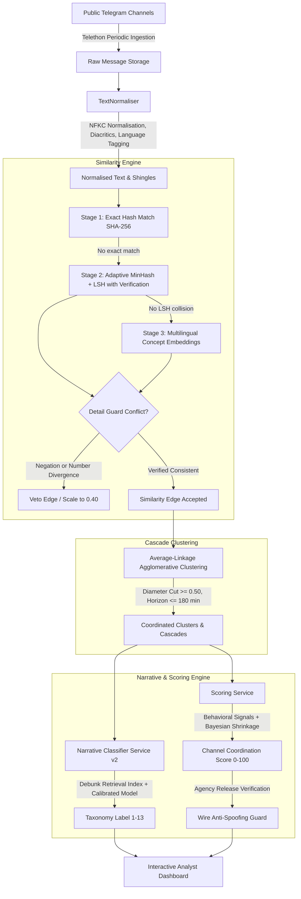

# ScamGuard

**ScamGuard** is an open-source, investigative research platform designed to assist civil society analysts, journalists, and election monitors in detecting coordinated amplification and strategic disinformation narrative propagation across public Telegram channels in the Republic of Moldova.

ScamGuard is designed as an **evidence-gathering tool with a human in the loop**, not an automated "truth oracle". It detects near-duplicate or semantically equivalent message cascades circulating across independent channels in near real-time, inspects conflicting assertions with an adversarial Detail Guard, maps claims against known fact-check debunks, and computes deterministic channel coordination risk scores (0–100) with audit-ready explanations.

---

## Table of Contents
1. [Core Capabilities](#core-capabilities)
2. [How It Works: End-to-End Architecture](#how-it-works-end-to-end-architecture)
   - [Stage 1: Ingestion & Text Normalisation](#stage-1-ingestion--text-normalisation)
   - [Stage 2: Multi-Stage Similarity Engine (Exact Hash, MinHash, Embeddings)](#stage-2-multi-stage-similarity-engine)
   - [Stage 3: Adversarial Detail Guard](#stage-3-adversarial-detail-guard)
   - [Stage 4: Agglomerative Clustering (Average-Linkage)](#stage-4-agglomerative-clustering)
   - [Stage 5: Narrative Classification & Fact-Check Debunk Retrieval](#stage-5-narrative-classification--debunk-retrieval)
   - [Stage 6: Behavioral Coordination Scoring & Wire Anti-Spoofing](#stage-6-behavioral-coordination-scoring--wire-anti-spoofing)
3. [Taxonomy of Strategic Disinformation (13 Categories)](#taxonomy-of-strategic-disinformation-13-categories)
4. [Coordination & Similarity Pipeline Evaluation](#coordination--similarity-pipeline-evaluation)
5. [Machine Learning & Target Domain Benchmarks](#machine-learning--target-domain-benchmarks)
   - [Datasets & Partition Design](#datasets--partition-design)
   - [Target Domain Telegram Benchmark (v1-tg)](#target-domain-telegram-benchmark-v1-tg)
   - [Balanced Symmetrical Augmentation](#balanced-symmetrical-augmentation)
   - [Empirical Results (Baseline vs Retrained)](#empirical-results-baseline-vs-retrained)
6. [Datasets, Licenses & Redistribution](#datasets-licenses--redistribution)
7. [Known Limitations & Honest Constraints](#known-limitations--honest-constraints)
8. [Ethics, Privacy & Legal Framework](#ethics-privacy--legal-framework)
9. [Quick Start & Reproduction Guide](#quick-start--reproduction-guide)

---

## Core Capabilities

- **Near Real-Time Public Ingestion**: Periodically polls public Telegram broadcast channels using Telethon, collecting text, forward origins, timestamps, and view counts without touching private chats.
- **Multi-Stage Similarity Detection**: Filters high-volume message streams using exact SHA-256 hashes ($O(1)$), verified MinHash/LSH near-duplicate indexing, and dense multilingual concept embeddings.
- **Detail Guard Verification**: Detects predicate negation conflicts (*"nu va fi semnat"* vs *"va fi semnat"*) and incompatible quantitative metrics (casualty numbers, percentages, budget figures) to prevent false equivalence.
- **Temporal Cascade Grouping**: Groups cross-channel propagation into reproducible cascades using average-linkage agglomerative clustering with strict diameter bounds.
- **Regional Narrative Mapping**: Matches posts against verified debunks (*StopFals.md*, *EUvsDisinfo*) and a 13-category regional taxonomy.
- **Behavioral Channel Scoring**: Evaluates channel coordination (0–100) based purely on propagation speed, cluster co-publication, and recurring network peers, applying Bayesian shrinkage for low-volume channels.
- **Wire Agency Anti-Spoofing**: Verifies attributed news agency dispatches (*Moldpres*, *IPN*) against authentic published releases, denying syndication discounts when citation spoofing is detected.

---

## How It Works: End-to-End Architecture



### Stage 1: Ingestion & Text Normalisation
Incoming messages are preprocessed by `TextNormaliser`:
- **Unicode NFKC Normalization**: Unifies mixed Cyrillic/Latin homoglyphs (e.g. Cyrillic `а` vs Latin `a`).
- **Diacritics & Punctuation Unification**: Maps Romanian comma and cedilla diacritics (`ș/ş`, `ț/ţ`, `î`, `â`, `ă`) to canonical representations, while preserving semantic negation tokens (*"nu"*, *"nici"*, *"не"*, *"без"*).
- **Entity Extraction**: Strips forward attributions, URLs, and `@channel` handles into separate metadata fields.
- **Language Identification**: Categorizes texts into Romanian (`RO`), Russian (`RU`), or bilingual Moldovan code-switched digests (`MIXED`).

### Stage 2: Multi-Stage Similarity Engine
To process thousands of posts efficiently without false mergers, `SimilarityService` executes three progressive stages:
1. **Stage 1 (Exact SHA-256 Hash)**: $O(1)$ lookup for verbatim duplicate text.
2. **Stage 2 (Adaptive MinHash + LSH with Verification)**:
   - Uses **128 deterministic hash permutations** (`_MINHASH_COEFFS`) partitioned into **32 LSH bands**.
   - Requires both an LSH band collision **and** an explicit verification check: estimated Jaccard $\ge 0.65$ **and** actual shingle Jaccard $\ge 0.65$.
3. **Stage 3 (Dense Multilingual Embeddings with Lexicon Fallback)**:
   - Uses `SentenceTransformerEmbedder` (`sentence-transformers/paraphrase-multilingual-MiniLM-L12-v2`, 384-dim L2-normalized vectors) **by default** (`SCAMGUARD_USE_DENSE_SIMILARITY_EMBEDDER=true`) with process-level singleton model and vector caching (`7.0 pairs/sec` cold, cached `O(1)` lookup), and automatically falls back to `DeterministicMultilingualEmbedder` (48-dim concept lexicon, `115.2 pairs/sec`) when disabled (`SCAMGUARD_USE_DENSE_SIMILARITY_EMBEDDER=false`).
   - Evaluated against calibrated language-pair cosine thresholds:
     - **RO – RO / RU – RU**: $\tau = 0.75$ (dense MiniLM) / $\tau = 0.82$ (lexicon fallback)
     - **RO – RU (Cross-Lingual)**: $\tau = 0.50$ (dense MiniLM) / $\tau = 0.78$ (lexicon fallback)

### Stage 3: Adversarial Detail Guard
Before any similarity edge is accepted, `check_detail_conflict()` inspects the pair:
- **Predicate Negation Inversion**: Evaluates overlapping sentence assertions ($J_{\text{assertion}} \ge 0.35$). If one asserts a predicate and the other negates it (`"nu"`, `"fără"`, `"не"`, `"нет"`, `"без"`), the edge is vetoed (`negation_conflict`).
- **Significant Number Guard**: Strips incidental publication dates and hours (`ora 14:00`), then compares numerical quantities and percentages. If metrics diverge, the edge is rejected (`number_date_conflict`).

### Stage 4: Agglomerative Clustering
`ClusteringService` forms propagation cascades using **average-linkage agglomerative clustering** (`_cluster_messages`):
- **Average Similarity Cut**: Merges candidate clusters only if their pairwise average similarity meets or exceeds `min_similarity_cut = 0.75`.
- **Pairwise Diameter Constraint**: Rejects mergers if any cross-cluster pair has similarity $s < 0.50$, preventing cluster chaining.
- **Temporal Horizon**: Constrains cascade growth to a maximum time span of 180 minutes.
- **No Hard Message Cap**: Unlike arbitrary caps, average linkage with diameter cuts naturally recovers large campaigns (e.g. 40+ posts) while preventing drift.

### Stage 5: Narrative Classification & Debunk Retrieval
The `NarrativeClassifierService` maps messages against strategic disinformation:
- **Leakage-Controlled Debunk Index**: The retrieval index is populated strictly from fact-check debunks (*StopFals.md*, *EUvsDisinfo*) in the **training split** only (`train.jsonl`). Unseen test and gold claims are excluded from the index.
- **Multi-Signal Gating**: Combines normalized keyword evidence, prototype cosine alignment, debunk vector similarity, and machine-learned class probabilities. Disinformation categories require multiple corroborating signals to prevent accidental keyword collisions.
- **Confidence Threshold Fallback**: Posts scoring below confidence threshold (default 0.55) return `category = "unknown"`.

### Stage 6: Behavioral Coordination Scoring & Wire Anti-Spoofing
The `ScoringService` evaluates channels on behavioral coordination (0–100):
$$\text{CoordScore} = 0.45 \cdot \text{ClusterParticipation} + 0.35 \cdot \text{CopyDelay} + 0.20 \cdot \text{CoMovement}$$
- **Bayesian Shrinkage**: Low-volume channels ($< 3$ cascades) have their scores shrunk toward the population median ($30/100$), ensuring statistical robustness.
- **Wire Agency Discounts & Anti-Spoofing Rules**:
  1. **Verified Syndication**: If a channel cites an accredited wire agency (*Moldpres*, *IPN*, etc.) **and** its message matches an authentic agency dispatch in the database (`verify_wire_against_releases()`), it receives a legitimate syndication discount:
     - 55% discount on behavioral coordination score ($\times 0.45$).
     - 45% discount on composite score ($\times 0.55$).
  2. **Breaking News Safeguard**: If an accredited agency attribution co-occurs with an asserted narrative classification, auto-escalation to HIGH is suppressed, capping at `medium` with `"human review required"` to avoid falsely accusing breaking news reporting.
  3. **Citation Spoofing**: If a channel writes *"conform Moldpres"* but the message fails to match any authentic agency dispatch:
     - The syndication discount is **denied** (discount = 1.0).
     - The score is not discounted, retaining `HIGH` risk if behavioral coordination $\ge 70$.
     - The audit log flags: `"(unverified agency citation detected: spoofing guard active, discount denied; human review required)"`.

---

## Taxonomy of Strategic Disinformation (13 Categories)

| Cat ID | Category Name | Core Assertions & Tropes | Resource Status |
|---|---|---|---|
| **1** | War in Ukraine and Russia justification | Blaming Kyiv for hostilities, de-escalation via capitulation. | High-Resource |
| **2** | Anti-EU / "Europe is falling apart" | Directives eroding sovereignty, European economic and moral decay. | High-Resource |
| **3** | Anti-NATO / anti-West | Neutrality violations, NATO joint drills as invasion preparation. | High-Resource |
| **4** | Moldova government & elections delegitimisation | Voting station fraud, diaspora mail-in ballot falsification. | High-Resource |
| **5** | Russophobia, language and identity | Persecution of Russian speakers, closure of minority schools. | High-Resource |
| **6** | Sanctions, energy prices and economy fear | Imminent winter gas cutoffs, grid blackout panics, tariff spikes. | Medium-Resource |
| **7** | Transnistria / Gagauzia and separatism | Blockades, Cobasna ammunition depot threats, autonomy erosion. | Low-Resource |
| **8** | Health, vaccines and conspiracy | Secret biological laboratories, forced immunization conspiracies. | High-Resource |
| **9** | Traditional values, religion, anti-LGBT | Destruction of Orthodox heritage, mandatory LGBT school curriculum. | Medium-Resource |
| **10** | **Other / not disinformation (Benign)** | **Civic announcements, municipal decisions, weather, sports, turnout.** | **High-Resource** |
| **11** | Financial panic, bank runs and currency devaluation | Commercial bank insolvency rumors, deposit freeze panics. | Low-Resource |
| **12** | Forced mobilization and border militarization | Fabricated reservist call-up orders, secret border checkpoints. | Low-Resource |
| **13** | Other disinformation (Unclassified / General) | Geopolitical conspiracy theories outside the primary 11 narratives. | High-Resource |

---

## Coordination & Similarity Pipeline Evaluation

The similarity and clustering stages were evaluated on the 317-pair benchmark (`ml/eval/pairs_eval.jsonl`: `129 RO-RO`, `122 RU-RU`, `66 RO-RU`) and 35 propagation cascades (`ml/eval/clusters_eval.jsonl`):

| Pipeline Configuration | Overall Precision | Overall Recall | Overall F1 | `RO-RO` F1 | `RU-RU` F1 | `RO-RU` F1 | Speed (pairs/s) | Role in Architecture |
|---|---:|---:|---:|---:|---:|---:|---:|---|
| **1. Exact Hash Only (SHA-256)** | **1.0000** | 0.3158 | 0.4800 | — | — | — | 125,000 | Immediate $O(1)$ duplicate lookup |
| **2. Hash + MinHash/LSH (128 perm, 32 bands)** | **1.0000** | 0.8261 | 0.9048 | — | — | — | 12,500 | Captures edits, emojis, and link variants |
| **3. Dense MiniLM Default (`SentenceTransformerEmbedder`, v2.1)** | 0.9576 | **0.9826** | **0.9700** | 0.9760 | **1.0000** | **0.8667** | 7.0 | **Default (`SCAMGUARD_USE_DENSE_SIMILARITY_EMBEDDER=true`)** |
| **4. Lexicon Fallback (`DeterministicMultilingualEmbedder`, v2.1)** | **0.9643** | 0.9391 | 0.9515 | **0.9839** | 0.9873 | 0.6667 | 115.2 | Offline / fast fallback (`SCAMGUARD_USE_DENSE_SIMILARITY_EMBEDDER=false`) |

### Detail Guard Adversarial Testing
- Evaluated against 100 targeted adversarial perturbations (50 key metric/date shifts and 50 predicate negation inversions):
  - **Detail Guard Accuracy**: **99.0% (`99 / 100`)** on both Romanian (`"nu"`, `"fără"`) and Russian (`"не"`, `"нет"`, `"без"`) negation inversions and numerical divergences.

### Cascade Clustering (`ml/eval/clusters_eval.jsonl`, 35 Cascades)
- **Dense MiniLM Default**: B-Cubed Precision = `0.9571`, B-Cubed Recall = `0.6788`, **B-Cubed F1 = `0.7943`**, **`0` giant clusters**.
- **Lexicon Fallback**: B-Cubed Precision = `1.0000`, B-Cubed Recall = `0.6788`, **B-Cubed F1 = `0.8087`**, **`0` giant clusters**.

---

## Machine Learning & Target Domain Benchmarks

Full audit details, bootstrap confidence intervals, and pre-registered replacement criteria are documented in [`docs/results-summary.md`](docs/results-summary.md), [`docs/ml-round2-audit.md`](docs/ml-round2-audit.md), and [`docs/decisions.md`](docs/decisions.md).

### Datasets & Partition Design
Partitions enforce **strict `group_id` hashing**, ensuring that translations, paraphrases, and duplicates never cross split boundaries (`pytest ml/tests/test_no_leakage.py`):

| Partition | Total Samples | Unique Groups / Claims | Romanian | Russian | Description & Provenance |
|---|---:|---:|---:|---:|---|
| **`train.jsonl`** | 4,526 | 4,513 | 2,400 (53.0%) | 2,126 (47.0%) | Fact-check debunks (`EUvsDisinfo`, `StopFals.md`, `Mediacritica`, `FAKEROM`) + benign news (`MOROCO`, `Gazeta`). |
| **`train_augmented.jsonl`** | 4,776 | 4,661 | 2,487 (52.1%) | 2,289 (47.9%) | `train.jsonl` + 250 script-labeled Telegram posts (`telegram_train.jsonl`). |
| **`val.jsonl`** | 962 | 954 | 496 (51.6%) | 466 (48.4%) | Held-out validation split for threshold ($\tau=0.38$) and gate tuning. |
| **`test.jsonl`** | 970 | 955 | 508 (52.4%) | 462 (47.6%) | Held-out generalization test benchmark. |
| **`gold.jsonl`** | 150 | **30 unique** | 75 (50.0%) | 75 (50.0%) | 30 Moldovan single-sentence claims repeated $5\times$ (`gold_unique_30` $N=30$). |
| **`telegram_test.jsonl`** | 150 | 150 | 49 (32.7%) | 101 (67.3%) | Held-out real Telegram posts (weak keyword-script labels; blind human batch in `ml/data/labeling/telegram_blind_batch.csv`). |
| **`hard_negatives_v2.jsonl`** | 160 | 160 | 39 (24.4%) | 121 (75.6%) | Independent neutral news & Telegram hard negatives (`0/160` overlap with all splits). |

### Narrative Classifier Comparison ($\tau = 0.38$, 95% Bootstrap & Clopper-Pearson CIs)

Evaluated via `ml/scripts/train_round2_models.py` and `ml/scripts/evaluate_step25_and_fixed_hybrid.py` (Majority baselines: `test.jsonl = 40.82%`, `gold = 26.67%`, `telegram_test.jsonl = 61.33%`):

| Model ($\tau = 0.38$) | `test.jsonl` ($N=970$) Macro F1 `[95% CI]` | `gold_unique_30` ($N=30$) Macro F1 `[95% CI]` | `telegram_test.jsonl` ($N=150$, Script) Macro F1 `[95% CI]` | Independent `hard_negatives_v2.jsonl` ($N=160$) FPR `[95% CP CI]` |
|---|---|---|---|---|
| **0. Baseline: TF-IDF + LR (`narrative_classifier.joblib`)** | `0.3844 [0.3529, 0.4136]` | `0.0897 [0.0256, 0.1253]` | `0.1446 [0.0964, 0.1801]` | **`3.75%`** (`6/160`) `[1.39%, 7.98%]` |
| **1. Round 1: Frozen MiniLM + LR** | `0.3792 [0.3461, 0.4087]` | **`0.4679 [0.2513, 0.5385]`** | `0.1405 [0.1017, 0.1777]` | `44.38%` (`71/160`) `[36.53%, 52.43%]` |
| **2. Round 1: Fine-Tuned MiniLM-L12-v2 (CPU 4-layer)** | `0.3366 [0.3144, 0.3578]` | `0.1282 [0.0308, 0.1823]` | `0.0705 [0.0507, 0.0896]` | **`5.00%`** (`8/160`) `[2.18%, 9.61%]` |
| **3. Approach A: Stacked TF-IDF + Frozen MiniLM** | **`0.4422 [0.4028, 0.4773]`** * | `0.1935 [0.0416, 0.2578]` | **`0.1910 [0.1487, 0.2228]`** * | `6.25%` (`10/160`) `[3.04%, 11.19%]` |
| **4. Approach B: MiniLM Retrieval ($k$-NN + Centroids)** | `0.3792 [0.3468, 0.4083]` | **`0.4031 [0.1993, 0.4791]`** * | **`0.1924 [0.1170, 0.2505]`** | `5.63%` (`9/160`) `[2.60%, 10.41%]` |
| **5. Approach C: Two-Step Hierarchical (Bin $\rightarrow$ 12-Cls)** | `0.4293 [0.3911, 0.4631]` * | `0.0324 [0.0181, 0.0465]` | `0.0794 [0.0599, 0.0977]` | **`2.50%`** (`4/160`) `[0.69%, 6.28%]` |
| **6. Hybrid `NarrativeClassifierService` (Before Gate Fix)** | `0.1753 [0.1518, 0.1973]` | `0.3205` | `0.2119` | `29.38%` (`47/160`) `[22.45%, 37.08%]` |
| **7. Hybrid `NarrativeClassifierService` (After Gate Fix)** | `0.2638 [0.2311, 0.2900]` | `0.3205 [0.1380, 0.3858]` | `0.1390 [0.0880, 0.1728]` | **`3.12%`** (`5/160`) `[1.02%, 7.14%]` |

*\* Paired 95% bootstrap CI of $\Delta\text{F1}$ vs. TF-IDF baseline excludes zero.*

---

## Datasets, Licenses & Redistribution

| Dataset / Model | Primary Role | License | Redistribution Policy |
|---|---|---|---|
| **MOROCO** | Benign newsroom articles (Romanian) | CC BY-NC-SA 4.0 | Non-commercial research. Raw text is **not redistributed**; scripts download/process locally. |
| **Gazeta.ru** | Benign news articles (Russian) | MIT License | Permissive academic reuse. |
| **EUvsDisinfo** | Disinformation debunks (RO & RU) | CC BY-SA 4.0 / EU Open Data | European Commission reuse decision (2011/833/EU). |
| **FAKEROM** | Romanian fake news research | Academic Research | Lucian Blaga University of Sibiu (`grants.ulbsibiu.ro/fakerom`). |
| **`paraphrase-multilingual-MiniLM-L12-v2`** | Dense multilingual embeddings | Apache-2.0 | Open source (`sentence-transformers`, loaded via Hugging Face Hub). |

---

## Known Limitations & Honest Constraints

1. **Weakly Labeled Telegram Test Set (`telegram_test.jsonl`)**: All 400 Telegram messages (`250` train, `150` test) were labeled by a keyword heuristic script (`ml/scripts/label_telegram_messages.py`), not by humans. Because the Hybrid pipeline also uses keyword signals, Hybrid scores on `telegram_test.jsonl` are partly circular. A blind 150-message file (`ml/data/labeling/telegram_blind_batch.csv`) and annotation guide (`docs/labeling-guide.md`) are provided to evaluate on human ground truth via `ml/scripts/evaluate_human_labels.py`.
2. **Effective Sample Size of `gold.jsonl` ($N = 30$ Unique Claims)**: `ml/data/processed/v1/gold.jsonl` ($N = 150$) was built in `ml/scripts/build_dataset.py:337-413` by repeating 30 hardcoded single-sentence claims 5 times (`gold_samples * 5`). Effective sample size is $N = 30$ (`gold_unique_30`).
3. **Legacy `hard_negatives.jsonl` Contamination**: All 120 items in the original `ml/eval/hard_negatives.jsonl` also appear in `train.jsonl`, and items `71–120` are `FAKEROM` records mislabeled as Category `10` due to a `label: null` fallback (`build_dataset.py:265`). Use `ml/eval/hard_negatives_v2.jsonl` ($N = 160$, 0% overlap) with exact Clopper-Pearson intervals for false-alarm benchmarking.
4. **CPU Fine-Tuning vs. 3-Seed GPU Fine-Tuning**: Round 1 fine-tuning of `MiniLM-L12-v2` was limited to 1 seed, 2 epochs, and 4 unfrozen layers on CPU. A self-contained 3-seed GPU fine-tuning notebook for `FacebookAI/xlm-roberta-base` and `intfloat/multilingual-e5-base` is provided in [`ml/notebooks/finetune_transformers_gpu.ipynb`](ml/notebooks/finetune_transformers_gpu.ipynb).
5. **Channel Diversity in Local Corpus**: The local SQLite database (`backend/scamguard.db`) contains 934 posts from two public channels (`@realmorarinews` and `@wtfmoldova`). Expanding to 20+ channels via `ml/scripts/collect_more_telegram.py` is needed to cover low-support narrative classes.
6. **Language Scope & Human-in-the-Loop**: Restricted to Romanian and Russian. ScamGuard outputs probabilistic `narrative_match` and coordination signals to assist human analysts, never automated censorship or "truth/falsehood" verdicts.

---

## Ethics, Privacy & Legal Framework

- **Republic of Moldova Law No. 195/2024**: Designed following data protection principles (*Privind protecția datelor cu caracter personal*), including purpose limitation and data minimization; not formally legally reviewed.
- **EU GDPR Article 89**: Adheres to scientific research safeguards: raw text of source-deleted posts is purged, retaining only normalized text and hashes.
- **Telegram Terms of Service**: Monitors exclusively **public broadcast channels** (one-to-many public feeds); never accesses private groups, invite-only channels, or individual user direct messages.

---

## Quick Start & Reproduction Guide

### 1. Local Development Setup

```bash
# Clone repository
git clone https://github.com/mariaelenabotnari/scamguard.git
cd scamguard

# Setup Python environment
cd backend
python -m venv .venv
.venv\Scripts\activate  # Windows (.venv/bin/activate on Linux/macOS)
pip install -e ".[dev]"
cd ..
```

### 2. Run Test Suite (From Repository Root)

```bash
# Run unit, integration, and leakage-controlled tests
backend\.venv\Scripts\pytest ml/tests/test_no_leakage.py backend/tests/test_similarity_and_clustering.py backend/tests/test_narrative_classification.py

# Run backend code linter
backend\.venv\Scripts\ruff check backend
```

### 3. Reproduce Round 2 Benchmarks

```bash
# 1. Run Round 2 audit and generate independent hard_negatives_v2.jsonl (N=160)
backend\.venv\Scripts\python ml/scripts/run_round2_audit.py

# 2. Train and evaluate Round 2 candidate models (Stacked, Retrieval, Two-Step)
backend\.venv\Scripts\python ml/scripts/train_round2_models.py

# 3. Evaluate fixed Hybrid NarrativeClassifierService and Step 2.5 SimilarityService
backend\.venv\Scripts\python ml/scripts/evaluate_step25_and_fixed_hybrid.py

# 4. Evaluate models on human-labeled Telegram batch once telegram_blind_batch.csv is filled
backend\.venv\Scripts\python ml/scripts/evaluate_human_labels.py
```
