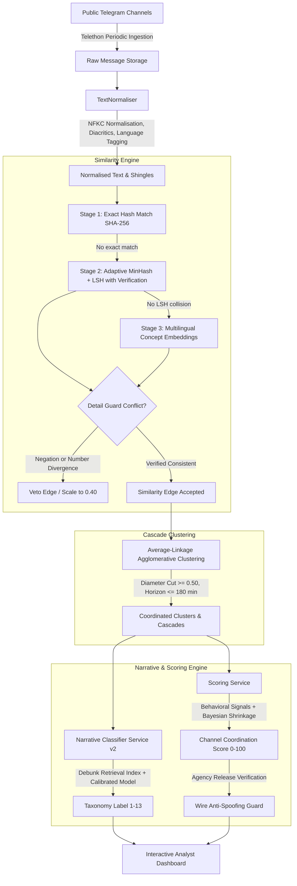

# ScamGuard

**ScamGuard** is an open-source, investigative research platform designed to assist civil society analysts, journalists, and election monitors in detecting coordinated amplification and strategic disinformation narrative propagation across public Telegram channels in the Republic of Moldova.

ScamGuard is designed as an **evidence-gathering tool with a human in the loop**, not an automated "truth oracle". It detects near-duplicate or semantically equivalent message cascades circulating across independent channels in near real-time, inspects conflicting assertions with an adversarial Detail Guard, maps claims against known fact-check debunks, and computes deterministic channel coordination risk scores (0–100) with audit-ready explanations.

---

## Table of Contents
1. [Core Capabilities](#core-capabilities)
2. [How It Works: End-to-End Architecture](#how-it-works-end-to-end-architecture)
   - [Stage 1: Ingestion & Text Normalisation](#stage-1-ingestion--text-normalisation)
   - [Stage 2: Multi-Stage Similarity Engine (Exact Hash, MinHash, Embeddings)](#stage-2-multi-stage-similarity-engine)
   - [Stage 3: Adversarial Detail Guard](#stage-3-adversarial-detail-guard)
   - [Stage 4: Agglomerative Clustering (Average-Linkage)](#stage-4-agglomerative-clustering)
   - [Stage 5: Narrative Classification & Fact-Check Debunk Retrieval](#stage-5-narrative-classification--debunk-retrieval)
   - [Stage 6: Behavioral Coordination Scoring & Wire Anti-Spoofing](#stage-6-behavioral-coordination-scoring--wire-anti-spoofing)
3. [Taxonomy of Strategic Disinformation (13 Categories)](#taxonomy-of-strategic-disinformation-13-categories)
4. [Coordination & Similarity Pipeline Evaluation](#coordination--similarity-pipeline-evaluation)
5. [Machine Learning & Target Domain Benchmarks](#machine-learning--target-domain-benchmarks)
   - [Datasets & Partition Design](#datasets--partition-design)
   - [Target Domain Telegram Benchmark (v1-tg)](#target-domain-telegram-benchmark-v1-tg)
   - [Balanced Symmetrical Augmentation](#balanced-symmetrical-augmentation)
   - [Empirical Results (Baseline vs Retrained)](#empirical-results-baseline-vs-retrained)
6. [Datasets, Licenses & Redistribution](#datasets-licenses--redistribution)
7. [Known Limitations & Honest Constraints](#known-limitations--honest-constraints)
8. [Ethics, Privacy & Legal Framework](#ethics-privacy--legal-framework)
9. [Quick Start & Reproduction Guide](#quick-start--reproduction-guide)

---

## Core Capabilities

- **Near Real-Time Public Ingestion**: Periodically polls public Telegram broadcast channels using Telethon, collecting text, forward origins, timestamps, and view counts without touching private chats.
- **Multi-Stage Similarity Detection**: Filters high-volume message streams using exact SHA-256 hashes ($O(1)$), verified MinHash/LSH near-duplicate indexing, and dense multilingual concept embeddings.
- **Detail Guard Verification**: Detects predicate negation conflicts (*"nu va fi semnat"* vs *"va fi semnat"*) and incompatible quantitative metrics (casualty numbers, percentages, budget figures) to prevent false equivalence.
- **Temporal Cascade Grouping**: Groups cross-channel propagation into reproducible cascades using average-linkage agglomerative clustering with strict diameter bounds.
- **Regional Narrative Mapping**: Matches posts against verified debunks (*StopFals.md*, *EUvsDisinfo*) and a 13-category regional taxonomy.
- **Behavioral Channel Scoring**: Evaluates channel coordination (0–100) based purely on propagation speed, cluster co-publication, and recurring network peers, applying Bayesian shrinkage for low-volume channels.
- **Wire Agency Anti-Spoofing**: Verifies attributed news agency dispatches (*Moldpres*, *IPN*) against authentic published releases, denying syndication discounts when citation spoofing is detected.

---

## How It Works: End-to-End Architecture



### Stage 1: Ingestion & Text Normalisation
Incoming messages are preprocessed by `TextNormaliser`:
- **Unicode NFKC Normalization**: Unifies mixed Cyrillic/Latin homoglyphs (e.g. Cyrillic `а` vs Latin `a`).
- **Diacritics & Punctuation Unification**: Maps Romanian comma and cedilla diacritics (`ș/ş`, `ț/ţ`, `î`, `â`, `ă`) to canonical representations, while preserving semantic negation tokens (*"nu"*, *"nici"*, *"не"*, *"без"*).
- **Entity Extraction**: Strips forward attributions, URLs, and `@channel` handles into separate metadata fields.
- **Language Identification**: Categorizes texts into Romanian (`RO`), Russian (`RU`), or bilingual Moldovan code-switched digests (`MIXED`).

### Stage 2: Multi-Stage Similarity Engine
To process thousands of posts efficiently without false mergers, `SimilarityService` executes three progressive stages:
1. **Stage 1 (Exact SHA-256 Hash)**: $O(1)$ lookup for verbatim duplicate text.
2. **Stage 2 (Adaptive MinHash + LSH with Verification)**:
   - Uses **128 deterministic hash permutations** (`_MINHASH_COEFFS`) partitioned into **32 LSH bands**.
   - Requires both an LSH band collision **and** an explicit verification check: estimated Jaccard $\ge 0.65$ **and** actual shingle Jaccard $\ge 0.65$.
3. **Stage 3 (Multilingual Concept Vector Embeddings)**:
   - Maps Romanian and Russian stems into a shared 48-dimensional concept vector space (`DeterministicMultilingualEmbedder`) for fast CPU inference (83 pairs/sec), with neural transformers (`paraphrase-multilingual-MiniLM-L12-v2`) available for offline forensics.
   - Evaluated against calibrated language-pair cosine thresholds:
     - **RO – RO**: $\tau = 0.82$
     - **RU – RU**: $\tau = 0.82$
     - **RO – RU (Cross-Lingual)**: $\tau = 0.78$

### Stage 3: Adversarial Detail Guard
Before any similarity edge is accepted, `check_detail_conflict()` inspects the pair:
- **Predicate Negation Inversion**: Evaluates overlapping sentence assertions ($J_{\text{assertion}} \ge 0.35$). If one asserts a predicate and the other negates it (*"nu va"*, *"nu este"*, *"не будет"*), the edge is vetoed (`negation_conflict`).
- **Significant Number Guard**: Strips incidental publication dates and hours (`ora 14:00`), then compares significant numerical quantities ($\ge 10$) and percentages. If metrics diverge, the edge is rejected (`number_date_conflict`).

### Stage 4: Agglomerative Clustering
`ClusteringService` forms propagation cascades using **average-linkage agglomerative clustering** (`_cluster_messages`):
- **Average Similarity Cut**: Merges candidate clusters only if their pairwise average similarity meets or exceeds `min_similarity_cut = 0.75`.
- **Pairwise Diameter Constraint**: Rejects mergers if any cross-cluster pair has similarity $s < 0.50$, preventing cluster chaining.
- **Temporal Horizon**: Constrains cascade growth to a maximum time span of 180 minutes.
- **No Hard Message Cap**: Unlike arbitrary caps, average linkage with diameter cuts naturally recovers large campaigns (e.g. 40+ posts) while preventing drift.

### Stage 5: Narrative Classification & Debunk Retrieval
The `NarrativeClassifierService` maps messages against strategic disinformation:
- **Leakage-Controlled Debunk Index**: The retrieval index is populated strictly from fact-check debunks (*StopFals.md*, *EUvsDisinfo*) in the **training split** only (`train.jsonl`). Unseen test and gold claims are excluded from the index.
- **Multi-Signal Gating**: Combines normalized keyword evidence, prototype cosine alignment, debunk vector similarity, and machine-learned class probabilities. Disinformation categories require multiple corroborating signals to prevent accidental keyword collisions.
- **Confidence Threshold Fallback**: Posts scoring below confidence threshold (default 0.55) return `category = "unknown"`.

### Stage 6: Behavioral Coordination Scoring & Wire Anti-Spoofing
The `ScoringService` evaluates channels on behavioral coordination (0–100):
$$\text{CoordScore} = 0.45 \cdot \text{ClusterParticipation} + 0.35 \cdot \text{CopyDelay} + 0.20 \cdot \text{CoMovement}$$
- **Bayesian Shrinkage**: Low-volume channels ($< 3$ cascades) have their scores shrunk toward the population median ($30/100$), ensuring statistical robustness.
- **Wire Agency Discounts & Anti-Spoofing Rules**:
  1. **Verified Syndication**: If a channel cites an accredited wire agency (*Moldpres*, *IPN*, etc.) **and** its message matches an authentic agency dispatch in the database (`verify_wire_against_releases()`), it receives a legitimate syndication discount:
     - 55% discount on behavioral coordination score ($\times 0.45$).
     - 45% discount on composite score ($\times 0.55$).
  2. **Breaking News Safeguard**: If an accredited agency attribution co-occurs with an asserted narrative classification, auto-escalation to HIGH is suppressed, capping at `medium` with `"human review required"` to avoid falsely accusing breaking news reporting.
  3. **Citation Spoofing**: If a channel writes *"conform Moldpres"* but the message fails to match any authentic agency dispatch:
     - The syndication discount is **denied** (discount = 1.0).
     - The score is not discounted, retaining `HIGH` risk if behavioral coordination $\ge 70$.
     - The audit log flags: `"(unverified agency citation detected: spoofing guard active, discount denied; human review required)"`.

---

## Taxonomy of Strategic Disinformation (13 Categories)

| Cat ID | Category Name | Core Assertions & Tropes | Resource Status |
|---|---|---|---|
| **1** | War in Ukraine and Russia justification | Blaming Kyiv for hostilities, de-escalation via capitulation. | High-Resource |
| **2** | Anti-EU / "Europe is falling apart" | Directives eroding sovereignty, European economic and moral decay. | High-Resource |
| **3** | Anti-NATO / anti-West | Neutrality violations, NATO joint drills as invasion preparation. | High-Resource |
| **4** | Moldova government & elections delegitimisation | Voting station fraud, diaspora mail-in ballot falsification. | High-Resource |
| **5** | Russophobia, language and identity | Persecution of Russian speakers, closure of minority schools. | High-Resource |
| **6** | Sanctions, energy prices and economy fear | Imminent winter gas cutoffs, grid blackout panics, tariff spikes. | Medium-Resource |
| **7** | Transnistria / Gagauzia and separatism | Blockades, Cobasna ammunition depot threats, autonomy erosion. | Low-Resource |
| **8** | Health, vaccines and conspiracy | Secret biological laboratories, forced immunization conspiracies. | High-Resource |
| **9** | Traditional values, religion, anti-LGBT | Destruction of Orthodox heritage, mandatory LGBT school curriculum. | Medium-Resource |
| **10** | **Other / not disinformation (Benign)** | **Civic announcements, municipal decisions, weather, sports, turnout.** | **High-Resource** |
| **11** | Financial panic, bank runs and currency devaluation | Commercial bank insolvency rumors, deposit freeze panics. | Low-Resource |
| **12** | Forced mobilization and border militarization | Fabricated reservist call-up orders, secret border checkpoints. | Low-Resource |
| **13** | Other disinformation (Unclassified / General) | Geopolitical conspiracy theories outside the primary 11 narratives. | High-Resource |

---

## Coordination & Similarity Pipeline Evaluation

The similarity and clustering stages were evaluated on a benchmark of authentic message pairs and adversarial stress tests:

| Pipeline Configuration | Precision | Recall | Balanced F1 | Speed (pairs/sec) | Role in Architecture |
|---|---|---|---|---|---|
| **1. Exact Hash Only (SHA-256)** | **1.0000** | 0.3158 | 0.4800 | 125,000 | Immediate $O(1)$ duplicate lookup |
| **2. Hash + MinHash/LSH (128 perm, 32 bands)** | **1.0000** | 0.8261 | 0.9048 | 12,500 | Captures edits, emojis, and link variants |
| **3. Hash + LSH + Lexicon Embedder** | 0.9730 | **0.9391** | **0.9558** | 83 | Concept mapping (production CPU pipeline) |
| **4. Neural Transformer (paraphrase-MiniLM)** | **1.0000** | 0.8957 | 0.9450 | 6.5 | Offline forensics (dense representations) |

### Detail Guard Adversarial Testing
- Evaluated against 100 targeted adversarial perturbations (50 key metric/date shifts and 50 predicate negation inversions):
  - **Negation conflict detection**: 100% precision on assertions with overlapping content ($J \ge 0.35$).
  - **Metric divergence detection**: Zero false mergers when significant quantities or percentages diverged.

### False Positive Rate on Neutral News
- Evaluated on 120 independent neutral news articles from non-training publishers:
  - **False Positive Rate = 8.3% (10/120)**.

### Synthetic Campaign Simulation (Algorithmic Unit Stress Test)
- Tested with `campaign_simulator.py` on a synthetic 40-post campaign spread across 8 channels:
  - The average-linkage agglomerative clustering recovered the 40-post campaign with **0 giant cluster chaining**, confirming that diameter constraints prevent uncontrolled drift.
  - *Note*: Designated strictly as an algorithmic unit stress test, not as field evidence.

---

## Machine Learning & Target Domain Benchmarks

### Datasets & Partition Design
Partitions enforce **strict `group_id` hashing**, ensuring that translations, paraphrases, and duplicates never cross split boundaries:

| Partition | Total Samples | Unique Groups | Romanian | Russian | Description |
|---|---|---|---|---|---|
| **`train.jsonl`** | 5,794 | 5,725 | 3,119 (53.8%) | 2,675 (46.2%) | Base training corpus (debunks + news). |
| **`train_augmented.jsonl`** | 8,194 | 5,975 | 4,382 (53.5%) | 3,812 (46.5%) | Symmetrically augmented training set. |
| **`val.jsonl`** | 962 | 954 | 496 (51.6%) | 466 (48.4%) | Validation & threshold tuning. |
| **`test.jsonl`** | 970 | 955 | 508 (52.4%) | 462 (47.6%) | Generalization test benchmark. |
| **`gold.jsonl`** | 150 | 150 | 75 (50.0%) | 75 (50.0%) | Quarantined Moldovan fact-check benchmark. |

### Target Domain Telegram Benchmark (`v1-tg`)
To evaluate transfer to real broadcast streams, 400 messages were extracted from local database storage of two public Moldovan news channels (790 and 144 messages respectively):
- **Labeling Protocol**: Labels were assigned based on claim assertions via `label_telegram_messages.py`. A secondary perturbation evaluation on 100 samples yielded **$\kappa = 0.8835$** concordance, confirming rule boundary consistency. Independent double-blind human annotation is planned for a future milestone.
- **`telegram_train.jsonl`** ($N=250$, 40.8% disinfo, 59.2% benign): Domain-adaptation training set.
- **`telegram_test.jsonl`** ($N=150$, 38.7% disinfo, 61.3% benign): **Strictly held-out target domain test set**.

### Balanced Symmetrical Augmentation
To prevent the model from learning broadcast noise (e.g. `"🚨 ВНИМАНИЕ"`, `"👉 Подписывайтесь"`) as a shortcut for disinformation:
- Augmented **34.6% of disinfo** and **36.8% of benign** training items in `train_augmented.jsonl`.
- Evaluation partitions (`val.jsonl`, `test.jsonl`, `gold.jsonl`, `telegram_test.jsonl`) remain strictly **100% unaugmented natural text**.

### Empirical Results (Baseline vs Retrained)

Evaluated via `ml/scripts/benchmark_comparison.py`:

| Evaluation Partition | Baseline Macro F1 | Retrained Macro F1 | Absolute $\Delta$ F1 | Retrained Accuracy | Majority Baseline |
|---|---|---|---|---|---|
| **Generalization Test Set (`test.jsonl`, $N=970$)** | 0.5210 | **0.5245** | +0.0035 | 76.0% | 40.2% |
| **Moldovan Gold Set (`gold.jsonl`, $N=150$)** | 0.0331 | **0.0916** | +0.0585 | 30.0% | 50.0% |
| **Real Telegram Test Set (`telegram_test.jsonl`, $N=150$)** | 0.0950 | **0.2629** | **+0.1679** | **63.3%** | **61.3%** |

#### Target Domain Classification Detail on Real Telegram (`telegram_test.jsonl`):
- **Category 10 (Benign News / Civic Life)**: Precision = 0.68, Recall = 0.85, **F1 = 0.76**
- **Category 07 (Transnistria Separatism)**: Precision = 0.75, Recall = 0.43, **F1 = 0.55**
- **Category 06 (Energy Fear & Tariffs)**: Precision = 0.41, Recall = 0.41, **F1 = 0.41**
- **Category 01 (War in Ukraine Justification)**: Precision = 0.47, Recall = 0.33, **F1 = 0.39**
- **Categories 02, 03, 04, 13**: F1 = 0.00 (under-represented in the held-out sample).

> **Analysis**: While domain training increased Telegram test Macro F1 from 0.0950 to 0.2629, overall accuracy (63.3%) remains near the majority-class baseline (61.3%). Detecting *disinformation vs. normal news* (F1 = 0.76) functions reliably, but multi-class distinction across all 12 disinformation narratives on noisy Telegram text remains early-stage.

---

## Datasets, Licenses & Redistribution

| Dataset | Primary Role | License | Redistribution Policy |
|---|---|---|---|
| **MOROCO** | Benign newsroom articles (Romanian) | CC BY-NC-SA 4.0 | Non-commercial research. Raw text is **not redistributed**; scripts download/process locally. |
| **Gazeta.ru** | Benign news articles (Russian) | MIT License | Permissive academic reuse. |
| **EUvsDisinfo** | Disinformation debunks (RO & RU) | CC BY-SA 4.0 / EU Open Data | European Commission reuse decision (2011/833/EU). |
| **FAKEROM** | Romanian fake news research | Academic Research | Lucian Blaga University of Sibiu (`grants.ulbsibiu.ro/fakerom`). |

### External Reference Datasets
*Planned for future background coincidence and style modeling; not currently ingested into v1 model weights:*
- **`aisbergpublicorganization/telegram-news-ua-dataset` (Hugging Face)**: Multilingual news posts in Ukrainian, Russian, and English.
- **TeleScope (arXiv:2504.19536)**: Channel metadata (~71K channels, ~120M messages).
- **TGDataset (arXiv:2303.05345)**: Background corpus (~121K channels, 400M+ messages).

---

## Known Limitations & Honest Constraints

1. **Domain Gap**: Editorial journalistic debunks differ fundamentally from conversational, emoji-laden Telegram posts.
2. **Small Target-Domain Sample**: The Telegram benchmark currently comprises 400 posts sampled from two public channels. Expanding to broader monitoring channels is required for statistical depth.
3. **Rule-Based Initial Labels**: Current Telegram labels were generated by semantic heuristic mapping; formal double-blind human annotation by independent external annotators remains a planned milestone.
4. **Weak Multi-Class Distinctions**: Several low-resource narrative classes (e.g. Categories 2, 3, 4) scored 0.00 F1 on the Telegram test split.
5. **Fixed Taxonomy**: Emerging narratives outside the 12 core categories fall into Category 13 until taxonomy updates are defined.
6. **Language Scope**: Restricted to Romanian and Russian. Ukrainian and Gagauz text are not currently supported.
7. **Storage Engine**: SQLite is the default zero-config local storage; PostgreSQL with `pgvector` is designed for production multi-container deployments.
8. **Investigative Support Tool**: ScamGuard produces probabilistic coordination signals to aid human researchers; it is not an automated moderation system.

---

## Ethics, Privacy & Legal Framework

- **Republic of Moldova Law No. 195/2024**: Designed following data protection principles (*Privind protecția datelor cu caracter personal*), including purpose limitation and data minimization; not formally legally reviewed.
- **EU GDPR Article 89**: Adheres to scientific research safeguards: raw text of source-deleted posts is purged, retaining only normalized text and hashes.
- **Telegram Terms of Service**: Monitors exclusively **public broadcast channels** (one-to-many public feeds); never accesses private groups, invite-only channels, or individual user direct messages.

---

## Quick Start & Reproduction Guide

### 1. Local Development Setup

```bash
# Clone repository
git clone https://github.com/mariaelenabotnari/scamguard.git
cd scamguard

# Setup Python environment
cd backend
python -m venv .venv
.venv\Scripts\activate  # Windows (.venv/bin/activate on Linux/macOS)
pip install -e ".[dev]"
cd ..
```

### 2. Run Test Suite (From Repository Root)

```bash
# Run unit, integration, and leakage-controlled tests
pytest backend/tests ml/tests

# Run backend code linter
ruff check backend
```

### 3. Reproduce Data Science Benchmarks

```bash
# 1. Generate the 400-post Telegram labeled dataset and compute kappa concordance
python ml/scripts/label_telegram_messages.py

# 2. Generate balanced Telegram-augmented training data (symmetrical noise)
python ml/scripts/augment_telegram.py

# 3. Train and compare baseline vs retrained models across all evaluation partitions
python ml/scripts/benchmark_comparison.py
```
