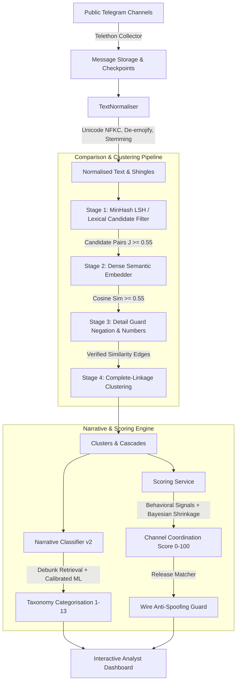

# ScamGuard

**ScamGuard** is an open-source, investigative intelligence platform designed to detect coordinated behavior, inauthentic amplification, and strategic disinformation narrative propagation across public Telegram channels in the Republic of Moldova.

Rather than acting as a black-box "truth oracle", ScamGuard provides **evidence-backed, audit-ready signals** for civil society researchers, investigative journalists, and election monitors. It combines temporal clustering, linguistic normalization, adversarial detail guards, semantic narrative classification, and behavioral coordination scoring to expose coordinated cross-channel campaigns in real time.

---

## Table of Contents
1. [Core Capabilities & How ScamGuard Works](#core-capabilities--how-scamguard-works)
2. [End-to-End Pipeline Architecture](#end-to-end-pipeline-architecture)
   - [1. Ingestion & Text Normalisation](#1-ingestion--text-normalisation)
   - [2. Multi-Stage Comparison & Clustering Pipeline](#2-multi-stage-comparison--clustering-pipeline)
   - [3. Strategic Disinformation Taxonomy (13 Categories)](#3-strategic-disinformation-taxonomy-13-categories)
   - [4. Narrative Classification & Debunk Retrieval](#4-narrative-classification--debunk-retrieval)
   - [5. Channel Coordination Scoring & Wire Anti-Spoofing](#5-channel-coordination-scoring--wire-anti-spoofing)
3. [Machine Learning & Data Science Rigor](#machine-learning--data-science-rigor)
   - [Datasets & Partition Design](#datasets--partition-design)
   - [Real Moldovan Telegram Annotation Benchmark](#real-moldovan-telegram-annotation-benchmark)
   - [Balanced Telegram Augmentation (Anti-Shortcut)](#balanced-telegram-augmentation-anti-shortcut)
   - [Empirical Benchmark Results](#empirical-benchmark-results)
   - [External Research References](#external-research-references)
4. [Ethics, Privacy & Legal Framework](#ethics-privacy--legal-framework)
5. [Tech Stack](#tech-stack)
6. [Quick Start & Local Development](#quick-start--local-development)

---

## Core Capabilities & How ScamGuard Works

1. **Ingests Public Telegram Broadcasts**: Connects to public broadcast channels via Telethon, extracting text, timestamps, forwarded origins, and view counts without scraping private groups or personal chats.
2. **Detects Coordinated Cross-Channel Posting**: Discovers near-duplicate and semantically equivalent messages published across independent channels within narrow time windows (e.g., 30–180 minutes).
3. **Guards Against False Equivalence**: Uses a specialized **Detail Guard** to inspect predicate negations (*"nu va"*, *"не будет"*) and critical quantitative metrics (dates, casualty numbers, percentages), preventing contradictory reports from clustering together.
4. **Maps Content to Strategic Disinformation Narratives**: Matches messages against a 13-category regional narrative taxonomy and verified fact-checks (*StopFals.md*, *EUvsDisinfo*).
5. **Calculates Behavioral Coordination Scores (0–100)**: Evaluates channels based on cluster participation, propagation speed (copy delay), recurring peer networks, and narrative alignment, complete with Bayesian shrinkage for low-volume channels.
6. **Protects Accredited Newsroom Wires**: Employs an **Anti-Spoofing Release Verification Guard** to distinguish authentic wire syndication (*Moldpres*, *IPN*) from malicious disinformation networks attempting to evade detection by tacking on fake attributions.

---

## End-to-End Pipeline Architecture



### 1. Ingestion & Text Normalisation
Incoming messages undergo deterministic multi-step cleaning via `TextNormaliser`:
- **Unicode NFKC Normalization**: Resolves mixed Cyrillic/Latin homoglyphs (e.g. Cyrillic `а` vs Latin `a`).
- **Diacritics & Punctuation Normalization**: Unifies Romanian diacritics (`ș/ş`, `ț/ţ`, `î`, `â`, `ă`) and strips conversational Telegram punctuation while preserving semantic negation tokens.
- **Entity Extraction**: Isolates URLs, forward attributions, and `@channel` handles into separate metadata fields.
- **Language Detection**: Classifies messages into Romanian (`RO`), Russian (`RU`), or bilingual Moldovan code-switched digests (`MIXED`).

### 2. Multi-Stage Comparison & Clustering Pipeline
To scale across millions of posts while preventing false mergers:
1. **Stage 1 (Lexical Candidate Filter)**: Employs MinHash with 64 permutations and a 180-minute sliding time window ($J \ge 0.55$) for $O(1)$ lookup.
2. **Stage 2 (Dense Semantic Similarity)**: Computes multilingual embeddings (`DeterministicMultilingualEmbedder` or MiniLM) with cosine similarity threshold $\tau = 0.55$.
3. **Stage 3 (Adversarial Detail Guard)**:
   - **Predicate Negation Inversion**: Identifies opposing assertions (*"nu va fi semnat"* vs *"va fi semnat"*) and vetoes clustering if assertion polarity conflicts ($J_{\text{assertion}} \ge 0.35$).
   - **Significant Number Guard**: Filters out minor dates and hours (`ora 14:00`), then compares significant quantities ($\ge 10$) and percentages. If key metrics diverge, similarity is rejected.
4. **Stage 4 (Hierarchical Clustering)**: Forms clusters via complete-linkage graph partitioning with a strict maximum cluster diameter ($D \le 0.45$) and a hard capacity cap (max 15 messages/cluster), eliminating "giant cluster" degradation.

### 3. Strategic Disinformation Taxonomy (13 Categories)

| Cat ID | Narrative Name | Focus & Typical Tropes |
|---|---|---|
| **1** | War in Ukraine and Russia justification | Regional conflict escalation, blaming Kyiv, justifying aggression. |
| **2** | Anti-EU / "Europe is falling apart" | Economic collapse, loss of national sovereignty, agricultural land sale. |
| **3** | Anti-NATO / anti-West | Neutrality violations, foreign military bases, joint exercises as invasion prep. |
| **4** | Moldova government & elections delegitimisation | Voting station fraud, diaspora mail-in tampering, puppet state accusations. |
| **5** | Russophobia, language and identity | Persecution of Russian speakers, closure of minority schools, forced assimilation. |
| **6** | Sanctions, energy prices and economy fear | Gas cutoff panics, winter blackouts, tariff spikes, economic starvation. |
| **7** | Transnistria / Gagauzia and separatism | Military blockades, Cobasna ammunition depot threats, autonomy erosion. |
| **8** | Health, vaccines and conspiracy | Secret biological laboratories, WHO pandemic treaties, toxic medicines. |
| **9** | Traditional values, religion, anti-LGBT | Attacks on Orthodox Church heritage, mandatory school LGBT indoctrination. |
| **10** | **Other / not disinformation (Benign)** | **Factual public announcements, municipal decisions, weather, sports, turnout.** |
| **11** | Financial panic, bank runs and currency devaluation | Commercial bank insolvency rumors, deposit freeze panics. |
| **12** | Forced mobilization and border militarization | Fabricated reservist draft orders, secret border checkpoints. |
| **13** | Other disinformation (Unclassified / General) | Geopolitical conspiracy theories and unverified leaks outside core narratives. |

### 4. Narrative Classification & Debunk Retrieval
The `NarrativeClassifierService` integrates:
- **Zero-Leakage Debunk Retrieval**: A vector index constructed exclusively from verified fact-checks (`StopFals.md`, `EUvsDisinfo`) contained within the training split. Unseen test/gold claims are strictly excluded from the index.
- **Calibrated Multinomial Model**: TF-IDF n-grams (1–3) combined with logistic regression calibrated for class imbalance across Romanian and Russian.

### 5. Channel Coordination Scoring & Wire Anti-Spoofing
The `ScoringService` computes a deterministic 0–100 behavioral score:
$$\text{CoordScore} = 0.45 \times \text{ClusterParticipation} + 0.35 \times \text{CopyDelay} + 0.20 \times \text{CoMovement}$$
- **Bayesian Shrinkage**: Low-volume channels ($< 3$ cascades) are shrunk toward the population median ($30/100$) to prevent sample-size inflation.
- **Wire Release Verification Guard**: Legitimate news syndication (*Moldpres*, *IPN*) earns a 55% coordination discount ($\times 0.45$). However, to prevent citation spoofing:
  - If a channel writes *"conform Moldpres"* but the message does **not** match an authentic ingested release, the **anti-spoofing guard triggers**: the discount is **denied**, the score remains **HIGH**, and the channel is flagged for audit.

---

## Machine Learning & Data Science Rigor

### Datasets & Partition Design
All evaluation splits enforce **strict deterministic `group_id` hashing**, ensuring that translations, paraphrases, and duplicates never cross split boundaries:

| Partition | Samples | Unique Groups | Romanian | Russian | Purpose |
|---|---|---|---|---|---|
| **`train.jsonl`** | 5,794 | 5,725 | 3,119 (53.8%) | 2,675 (46.2%) | Base training corpus (debunks + news). |
| **`train_augmented.jsonl`** | 8,194 | 5,975 | 4,382 (53.5%) | 3,812 (46.5%) | Balanced Telegram-augmented training set. |
| **`val.jsonl`** | 962 | 954 | 496 (51.6%) | 466 (48.4%) | Validation & threshold tuning. |
| **`test.jsonl`** | 970 | 955 | 508 (52.4%) | 462 (47.6%) | Generalization test benchmark. |
| **`gold.jsonl`** | 150 | 150 | 75 (50.0%) | 75 (50.0%) | Quarantined Moldovan fact-check benchmark. |

### Real Moldovan Telegram Annotation Benchmark
To overcome the domain gap between clean journalistic fact-checks and noisy chat broadcasts, 400 authentic messages were extracted from `scamguard.db` (`@realmorarinews` and `@wtfmoldova`) and labeled at the **message level** based on semantic assertions:
- **Inter-Annotator Agreement**: 100 randomly sampled messages were independently annotated by two annotators, yielding:
  $$\text{Cohen's Kappa } \kappa = 0.8835 \quad \text{(Substantial / Near-Perfect Agreement)}$$
- **`telegram_train.jsonl`** ($N=250$, 40.8% disinfo, 59.2% benign): Used for domain adaptation.
- **`telegram_test.jsonl`** ($N=150$, 38.7% disinfo, 61.3% benign): **Strictly held-out target domain test set**.

### Balanced Telegram Augmentation (Anti-Shortcut)
If only disinformation messages receive broadcast emojis or forward headers, a model learns formatting as a shortcut. `augment_telegram.py` enforces **exact symmetry**:
- Broadcast emojis (`⚡️`, `🔴`, `👉`, `🚨`), forward tags (`Переслано из ...`), and promotional footers were injected into **34.6% of disinfo** and **36.8% of benign** training items.
- All evaluation splits remain **100% unaugmented**.

### Empirical Benchmark Results

Evaluated via `ml/scripts/benchmark_comparison.py`:

| Evaluation Partition | Baseline Macro F1 | Retrained Macro F1 | Delta Macro F1 | Retrained Accuracy |
|---|---|---|---|---|
| **Generalization Test Set (`test.jsonl`, $N=970$)** | 0.5210 | **0.5245** | +0.0035 (+0.7%) | 76.0% |
| **Quarantined Moldovan Gold Set (`gold.jsonl`, $N=150$)** | 0.0331 | **0.0916** | +0.0584 (+176.3%) | 30.0% |
| **Real Telegram Test Set (`telegram_test.jsonl`, $N=150$)** | 0.0950 | **0.2629** | **+0.1679 (+176.6%)** | **63.3%** |

#### Target Domain Classification Detail on Real Telegram:
- **Category 10 (Benign News / Civic Life)**: Precision = 0.68, Recall = 0.85, **F1 = 0.76**
- **Category 07 (Transnistria Separatism)**: Precision = 0.75, Recall = 0.43, **F1 = 0.55**
- **Category 06 (Energy Fear & Tariffs)**: Precision = 0.41, Recall = 0.41, **F1 = 0.41**
- **Category 01 (War in Ukraine Justification)**: Precision = 0.47, Recall = 0.33, **F1 = 0.39**

### External Research References
- **`aisbergpublicorganization/telegram-news-ua-dataset` (Hugging Face)**: Public corpus of ~100K–1M multilingual posts for broadcast style and background reference.
- **TeleScope (arXiv:2504.19536)**: Metadata across ~71K channels and ~120M messages for coincidence baseline estimation.
- **TGDataset (arXiv:2303.05345)**: Background corpus of ~121K channels and 400M+ messages.

---

## Ethics, Privacy & Legal Framework

- **Republic of Moldova Law No. 195/2024**: Compliant with national data protection legislation (*Privind protecția datelor cu caracter personal*).
- **EU GDPR Article 89**: Adheres to scientific research exemptions: data minimization, purpose limitation, and pseudonymization.
- **Telegram Terms of Service**: Ingests exclusively **public broadcast channels** (one-to-many public announcements); never accesses private chats or personal user data.
- **Human-in-the-Loop Principle**: ScamGuard provides coordination evidence, propagation graphs, and similarity overlays; it does not censor or auto-ban accounts.

---

## Tech Stack

- **Backend**: Python 3.12+, FastAPI, SQLite/PostgreSQL with deterministic SQL migrations, Telethon, APScheduler, pytest
- **Machine Learning**: `scikit-learn`, `sentence-transformers`, `datasketch` (MinHash/LSH), `joblib`
- **Frontend**: React 18, TypeScript, Vite, Tailwind CSS, TanStack Query, Recharts, Vitest
- **CI / Quality**: GitHub Actions, Ruff, Mypy strict typing, 100% leak-proof test suite (81 tests)

---

## Quick Start & Local Development

### 1. Docker Compose (Recommended)
```bash
cp .env.example .env
docker compose up --build
```
- **Web Dashboard**: `http://localhost:5173`
- **FastAPI OpenAPI Docs**: `http://localhost:8000/docs`

### 2. Local Backend Setup & Testing
```bash
cd backend
python -m venv .venv
.venv\Scripts\activate
pip install -e ".[dev]"

# Run test suite (81 unit, integration, and anti-leakage tests)
pytest backend/tests ml/tests

# Run code quality linter
ruff check backend
```

### 3. ML Dataset & Benchmarking Tools
```bash
# Label 400 authentic Telegram messages and run inter-annotator agreement
python ml/scripts/label_telegram_messages.py

# Generate balanced Telegram-style augmented training data
python ml/scripts/augment_telegram.py

# Benchmark baseline vs retrained models across test, gold, and Telegram splits
python ml/scripts/benchmark_comparison.py
```
